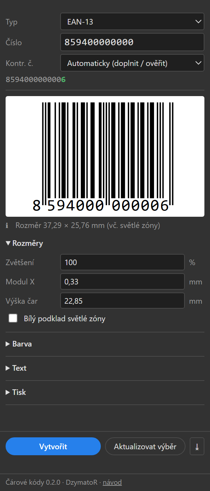

# Čárové kódy pro Adobe Illustrator

Panel, který vytváří čárové kódy přímo v dokumentu Illustratoru jako čisté vektory:
**EAN-13**, **ITF-14**, **Interleaved 2/5** a **QR kód**.

Tento návod popisuje instalaci, ovládání panelu, všechna nastavení a známá omezení.
Informace pro vývojáře jsou ve [VYVOJ.md](VYVOJ.md).

## Obsah

- [Instalace](#instalace)
- [Rychlý start](#rychlý-start)
- [Horní část panelu](#horní-část-panelu)
- [Rozměry](#rozměry)
- [Barva](#barva)
- [Text](#text)
- [Tisk](#tisk)
- [Tlačítka](#tlačítka)
- [Co vznikne v dokumentu](#co-vznikne-v-dokumentu)
- [Typy kódů](#typy-kódů)
- [Hlášení a varování](#hlášení-a-varování)
- [Známá omezení](#známá-omezení)
- [Řešení potíží](#řešení-potíží)
- [Podpora](#podpora)

## Instalace

Potřebujete Illustrator 2019 nebo novější na Windows. Práva správce nejsou potřeba.

1. Stáhněte `carove-kody-<verze>.zip` ze stránky [Releases](https://github.com/DzymatoR/illustrator-barcode-plugin/releases/latest) a celý ho rozbalte.
2. Zavřete Illustrator.
3. Dvojklikem spusťte `Instalovat.cmd`. Pokud Windows zobrazí modré okno „Systém Windows ochránil váš počítač“, klikněte na „Další informace“ a „Přesto spustit“.
4. Spusťte Illustrator a otevřete **Okno > Rozšíření > Čárové kódy**.

Panel se chová jako ostatní panely Illustratoru: dá se ukotvit, sbalit a zůstává otevřený mezi dokumenty.

- **Aktualizace:** stáhněte nový zip a spusťte `Instalovat.cmd` znovu, starou verzi přepíše. Číslo nainstalované verze je vidět dole v panelu.
- **Odebrání:** spusťte `Odinstalovat.cmd`.
- **Co instalace dělá:** zkopíruje panel do vašeho profilu (`%APPDATA%\Adobe\CEP\extensions`) a v registru uživatele povolí Illustratoru načítat nepodepsaná rozšíření. Rozbalenou složku pak můžete smazat.

## Rychlý start

1. Otevřete dokument (pro tisk v režimu CMYK).
2. V panelu vyberte **Typ** a do pole **Číslo** napište číslo kódu.
3. Zkontrolujte náhled a případná varování pod ním.
4. Klikněte na **Vytvořit** nebo stiskněte Enter v poli s číslem.

Kód se objeví uprostřed aktuálního pohledu v aktivní vrstvě a zůstane vybraný.

## Horní část panelu

| Prvek | Popis |
|---|---|
| **Typ** | EAN-13, ITF-14, Interleaved 2/5 nebo QR kód. Rozměry si panel pamatuje pro každý typ zvlášť. |
| **Číslo** / **Obsah** | Číslo kódu, mezery se ignorují. U QR libovolný text nebo adresa. |
| **Kontr. č.** | Jak naložit s kontrolní číslicí, viz níže. U QR se nezobrazuje. |
| Řádek pod číslem | Výsledné číslo, které se zakóduje. Dopočtená kontrolní číslice je zeleně. |
| **Náhled** | Průběžně ukazuje kód podle aktuálního nastavení. Písmo číslic v náhledu je jen orientační. |
| Zprávy pod náhledem | ✖ chyba (kód nejde vytvořit), ⚠ varování (kód jde vytvořit, ale něco je mimo doporučení), ℹ informace (výsledný rozměr). |

Možnosti kontrolní číslice:

| Volba | Typy | Chování |
|---|---|---|
| **Automaticky (doplnit / ověřit)** | EAN-13, ITF-14 | Zadáte-li číslo bez kontrolní číslice (12, resp. 13 číslic), panel ji dopočítá. Zadáte-li celé číslo, ověří ji a při chybě ukáže správnou. |
| **Vyžadovat a ověřit** | EAN-13, ITF-14 | Musíte zadat celé číslo včetně kontrolní číslice. Hodí se při přepisování z podkladů, kdy chcete odhalit překlep. |
| **Neověřovat** | EAN-13, ITF-14 | Celé číslo se zakóduje tak, jak je. Jen pro výjimečné případy. |
| **Bez kontrolní číslice** | Interleaved 2/5 | Zakóduje se přesně zadané číslo. |
| **Přidat (modulo 10)** | Interleaved 2/5 | Na konec se přidá kontrolní číslice počítaná stejně jako u EAN. |

## Rozměry

| Nastavení | Typy | Popis |
|---|---|---|
| **Zvětšení** | EAN-13 | Velikost v procentech nominálu (100 % = modul 0,33 mm, šířka 37,29 mm). Změna přepočítá modul i výšku čar. Doporučený rozsah je 80–200 %. |
| **Modul X** | všechny | Šířka nejužší čáry v mm, u QR velikost jednoho čtverečku. Od ní se odvíjí šířka celého kódu. |
| **Výška čar** | čárové kódy | Výška běžných čar v mm. U EAN-13 jsou ochranné čáry (krajní a středové) o 5 modulů delší. |
| **Poměr š:ú** | ITF-14, I2/5 | Kolikrát je široký prvek širší než úzký. Povoleno 2,25–3 u ITF-14, obvykle 2,5. |
| **Nosné pruhy** | ITF-14, I2/5 | Silné pruhy kolem kódu: žádné, nahoře a dole, nebo rám dokola. U ITF-14 na kartonu se běžně používá rám. |
| **Tloušťka** | ITF-14, I2/5 | Tloušťka nosných pruhů v mm (u ITF-14 při plné velikosti 4,8 mm). |
| **Korekce chyb** | QR | Kolik poškození kód snese: L 7 %, M 15 %, Q 25 %, H 30 %. Vyšší úroveň znamená větší kód. |
| **Světlá zóna** | QR | Šířka prázdného okraje kolem kódu v modulech. Norma požaduje aspoň 4. |
| **Bílý podklad světlé zóny** | všechny | Pod kód se vloží bílý obdélník v rozsahu celého kódu včetně světlých zón. Použijte, když kód leží na barevné ploše. |

Výchozí hodnoty: EAN-13 modul 0,33 mm a výška 22,85 mm; ITF-14 modul 1,016 mm, výška 31,75 mm, poměr 2,5 a rám 4,8 mm; Interleaved 2/5 modul 0,5 mm a výška 15 mm; QR modul 0,5 mm, korekce M a světlá zóna 4 moduly.

**Světlá zóna** je prázdné místo kolem kódu, do kterého nesmí zasahovat žádná grafika. U EAN-13 je 11 modulů vlevo a 7 vpravo, u ITF-14 a Interleaved 2/5 je 10 modulů na každé straně. Rozměr uvedený pod náhledem ji zahrnuje.

## Barva

| Nastavení | Popis |
|---|---|
| **Černá (K 100 v CMYK)** | V dokumentu CMYK mají čáry i číslice barvu 0/0/0/100, tedy jen černý výtažek. V dokumentu RGB se použije RGB 0/0/0. |
| **Vzorník dokumentu…** | Čáry i číslice dostanou barvu vybraného vzorníku (tón 100 %). V seznamu jsou přímé barvy a globální procesní barvy z aktuálního dokumentu, ty druhé mají poznámku „(globální)“. |
| **⟳** | Znovu načte vzorníky z dokumentu. Použijte po přidání nového vzorníku. |
| **Přetisk** | Zapne přetisk výplně u čar a číslic. Bílý podklad se nikdy nepřetiskuje. |

Řádek pod nastavením ukazuje, jaká barva se v aktuálním dokumentu skutečně použije.

## Text

Sekce se zobrazuje jen u čárových kódů, QR kód číslice nemá.

| Nastavení | Popis |
|---|---|
| **Zobrazit číslice** | Pod kód přidá čitelné číslo. U EAN-13 jsou číslice rozmístěné pod čarami, u ITF-14 ve skupinách (1 2 5 5 1) uprostřed pod kódem. |
| **Značka světlé zóny „>“** | Jen EAN-13. Za číslice přidá znak `>`, jehož špička označuje pravý okraj světlé zóny. |
| **Písmo** | **Automaticky (OCR-B)** použije první nalezené písmo OCR-B. Dál jsou v nabídce všechna nainstalovaná písma s „OCR“ v názvu. **Jiné…** otevře pole **Název**, kam napíšete název libovolného písma. |
| **Velikost** | Velikost písma v bodech. Prázdné pole znamená automatickou velikost podle modulu, její hodnota je v poli vidět šedě. |
| **Převést text na křivky** | Číslice se vloží jako křivky. Soubor pak nepotřebuje písmo, ale číslice už nejdou upravit jako text. |

## Tisk

| Nastavení | Popis |
|---|---|
| **Rozlišení** | Rozlišení výstupního zařízení v dpi (například 2400 pro CTP, 600 pro digitální tisk). Prázdné pole kontrolu vypne. |
| **Zaokrouhlit na body zařízení** | Upraví modul tak, aby vycházel na celý počet bodů zařízení. Zaokrouhlí se i korekce BWR a u ITF a Interleaved 2/5 šířka širokého prvku. Kód se tím mírně zvětší nebo zmenší. |
| **Korekce BWR** | Zúžení čar v mikrometrech, které vyrovnává nárůst bodu při tisku. Každá čára se zúží o zadanou hodnotu, mezery se o stejnou hodnotu rozšíří. U QR se zúží hrany tmavých ploch. Hodnotu vám sdělí tiskárna. |

Řádek pod nastavením ukazuje velikost jednoho bodu zařízení a kolik bodů připadá na modul. Když modul nevychází na celé body a zaokrouhlení je vypnuté, objeví se pod náhledem varování s doporučenou hodnotou modulu.

## Tlačítka

| Tlačítko | Popis |
|---|---|
| **Vytvořit** | Vloží nový kód doprostřed aktuálního pohledu do aktivní vrstvy. |
| **Aktualizovat výběr** | Nahradí vybraný kód novým podle aktuálního nastavení panelu. Levý horní roh světlé zóny, vrstva i pořadí objektů zůstanou stejné. |
| **⤓** | Načte do panelu nastavení, se kterým byl vybraný kód vytvořen. |

Typický postup při změně čísla: vyberte kód, klikněte na **⤓**, přepište číslo a klikněte na **Aktualizovat výběr**.

Obě funkce fungují jen u kódů vytvořených tímto panelem. Kód si nastavení nese v sobě, takže fungují i po zkopírování do jiného dokumentu nebo na jiném počítači.

Pod tlačítky se zobrazuje výsledek poslední akce a případná chyba. Úplně dole je verze panelu a odkaz na tento návod.

## Co vznikne v dokumentu

Každý kód je jedna skupina pojmenovaná podle typu a čísla, například `EAN-13 8594000000006`. Obsahuje:

- **Čáry**: jedna složená cesta se všemi čarami (u QR se všemi moduly), bez obrysu.
- **Číslice**: textové objekty, nebo křivky při zapnutém převodu.
- **Světlá zóna**: obdélník v rozměru celého kódu včetně světlých zón. Bez bílého podkladu je neviditelný (bez výplně a obrysu) a slouží k přichytávání a zarovnávání. Nemažte ho, podle něj se při aktualizaci určuje poloha kódu.

## Typy kódů

**EAN-13** je kód spotřebitelského zboží. Má 13 číslic, poslední je kontrolní.

**ITF-14** se používá na obchodních a přepravních baleních (kartony). Má 14 číslic, poslední je kontrolní. Bývá velký a tiskne se s nosným rámem.

**Interleaved 2/5** je obecný číselný kód libovolné délky pro interní použití. Kóduje číslice po dvojicích, takže jich musí být sudý počet. Při lichém počtu panel doplní na začátek nulu a upozorní na to.

**QR kód** pojme text nebo adresu včetně diakritiky. Velikost (verzi) volí panel automaticky podle délky obsahu a úrovně korekce. Čím delší obsah, tím víc modulů a tím větší kód při stejném modulu. Pod náhledem je vidět verze a počet modulů.

## Hlášení a varování

| Hlášení | Význam |
|---|---|
| Chybná kontrolní číslice: X, správně má být Y | Číslo je zadané s chybou, nebo patří k jinému kódu. Zkontrolujte podklady. |
| … potřebuje N číslic | Číslo má špatnou délku. |
| Modul X … je pod minimem / nad maximem | Kód je menší nebo větší, než dovoluje specifikace GS1 (EAN-13: 0,264–0,66 mm, ITF-14: 0,495–1,016 mm). |
| Zkrácená výška čar | Výška je menší než nominální pro daný modul. Zkrácený kód se hůř čte, používejte jen když není místo. |
| Výška čar … je pod minimem | ITF-14 má mít čáry vysoké aspoň 31,75 mm. |
| Poměr širokého prvku … je mimo rozsah | Poměr je mimo rozsah povolený pro daný typ. |
| Modul = N bodu při … dpi | Modul nevychází na celé body zařízení. Použijte doporučenou hodnotu nebo zapněte zaokrouhlení. |
| Korekce BWR je příliš velká vůči modulu | Zúžení je větší než polovina modulu. Zkontrolujte, že je hodnota v mikrometrech. |
| Písmo … nenalezeno, použito … | Zvolené písmo není nainstalované, použilo se náhradní. |
| Aktivní vrstva je zamčená nebo skrytá | Odemkněte vrstvu nebo vyberte jinou. |
| Ve výběru není čárový kód z tohoto pluginu | Aktualizovat a načíst lze jen kód vytvořený tímto panelem. |

Varování vytvoření kódu nebrání. Je na vás, zda je odchylka v dané zakázce přijatelná.

## Známá omezení

**Čtení a kvalita**
- Panel neověřuje čitelnost. Hlídá jen rozměry vůči specifikaci. Každý kód před odesláním do tisku zkontrolujte čtečkou nebo verifikátorem.
- Kontrast a vhodnost barev se nekontrolují. Čtečky používají červené světlo, takže červené, oranžové a žluté čáry nepřečtou.

**Úpravy v dokumentu**
- Změna velikosti kódu tažením za rohy změní modul i tloušťku čar a zruší zaokrouhlení na body zařízení. Velikost měňte v panelu a kód aktualizujte.
- **Aktualizovat výběr** kód vytvoří znovu. Ruční úpravy uvnitř skupiny, otočení a změna měřítka se tím ztratí, zachová se jen poloha.
- Kód se vkládá vždy doprostřed pohledu, umístění na konkrétní souřadnice panel neumí.

**Typy kódů**
- Chybí EAN-8, UPC-A, doplňkové kódy EAN-2 a EAN-5, Code 128, GS1-128 a Data Matrix.
- U Interleaved 2/5 je k dispozici jen kontrolní číslice modulo 10.
- QR kód neumí vložené logo, Micro QR ani strukturovaná data GS1. Text s diakritikou se ukládá v UTF-8 bez označení kódování, což běžné telefony čtou správně, některé starší průmyslové čtečky ale ne.
- Velké QR kódy (stovky znaků) se kreslí několik sekund.

**Barva a tisk**
- V dokumentu RGB vzniknou čáry v RGB černé. Pro tisk pracujte v dokumentu CMYK.
- Barva ze vzorníku se používá vždy v tónu 100 %.
- Korekce BWR se netýká nosných pruhů ani číslic. U QR kódu se neupravují vnitřní rohy tvarů.

**Písmo a text**
- Písmo OCR-B není součástí panelu. Když není nainstalované, použije se Arial.
- S nepřevedeným textem musí mít písmo i ten, kdo soubor otevře. Do tisku posílejte text převedený na křivky.

**Instalace**
- Instalační skript je jen pro Windows. Na macOS je nutná ruční instalace, viz [VYVOJ.md](VYVOJ.md).
- Rozšíření není podepsané, proto instalace zapíná v registru uživatele vývojářský režim rozšíření Adobe.

## Řešení potíží

| Potíž | Co zkusit |
|---|---|
| Panel není v nabídce Okno > Rozšíření | Zavřete Illustrator, spusťte znovu `Instalovat.cmd` a Illustrator spusťte znovu. Ověřte, že máte verzi 2019 nebo novější. |
| Panel je prázdný nebo bílý | Zavřete ho a otevřete znovu z nabídky Okno > Rozšíření. Pomůže i restart Illustratoru. |
| `Instalovat.cmd` skončí chybou | Pravděpodobně firemní nastavení blokuje skripty nebo zápis do registru. Obraťte se na IT. |
| V seznamu vzorníků chybí barva | Klikněte na ⟳. Barva musí být v panelu Vzorník jako přímá nebo globální. |
| V nabídce písem chybí OCR-B | Písmo nainstalujte a restartujte Illustrator, seznam písem se načítá při jeho spuštění. |
| Tlačítko Vytvořit je šedé | Číslo je prázdné nebo chybné, důvod je červeně pod náhledem. |
| Kód se nevytvořil | Přečtěte si hlášení pod tlačítky. Nejčastěji není otevřený dokument nebo je aktivní vrstva zamčená. |

Chyby a náměty hlaste autorovi nebo přes [Issues](https://github.com/DzymatoR/illustrator-barcode-plugin/issues). Připojte verzi panelu, verzi Illustratoru a text hlášení z panelu.

## Podpora

Panel je zdarma. Jestli vám šetří práci, můžete autora pozvat na kávu: [ko-fi.com/dzymator](https://ko-fi.com/dzymator). Stejný odkaz je i v patičce panelu.
